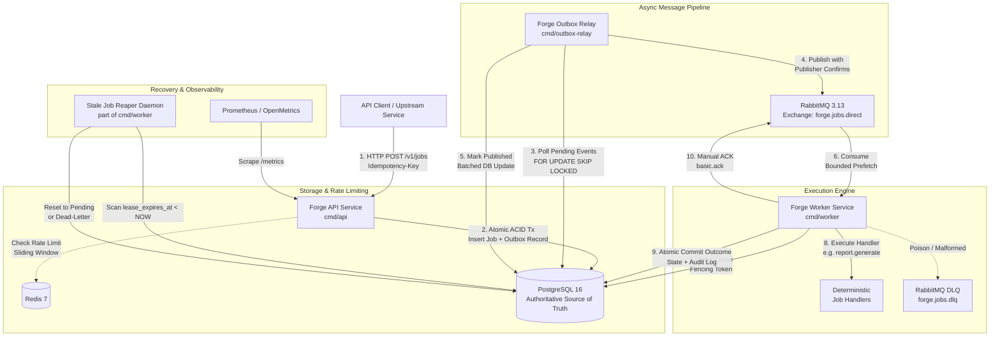

# Forge: High-Reliability Distributed Background Job Processing Platform

[](https://go.dev/)
[](https://github.com/YKalisjati/forge/actions/workflows/ci.yml)
[](LICENSE)
[](https://www.postgresql.org/)
[](https://www.rabbitmq.com/)
[](https://redis.io/)

Forge is an open-source, production-grade distributed background job processing platform written in Go. Designed to demonstrate senior-level backend and distributed systems engineering standards, Forge provides guaranteed at-least-once execution, client-driven idempotency, transactional outbox dispatch, optimistic fencing tokens, bounded concurrency, resilient crash recovery, and real-time observability.

---

## 1. Project Overview & Engineering Goals

Modern background job engines frequently suffer from dual-write anomalies (e.g. committing to a database and failing to enqueue on a broker), ghost worker executions (e.g. network-partitioned workers overwriting newer results), and retry storms that block broker queues. 

Forge addresses these challenges directly through rigorous distributed systems patterns:
- **No Dual-Write Bugs**: Eliminates split-brain database/broker dual-writes via the **Transactional Outbox Pattern**.
- **Deterministic Client Idempotency**: Prevents duplicate job creation through SHA-256 request payload fingerprinting and PostgreSQL advisory transaction locks.
- **Zombie Worker Immunity**: Enforces monotonic **fencing tokens (`execution_lease_id`)** to reject delayed state commits from stale or partitioned workers.
- **Reliable Retry Scheduling**: Schedules exponential backoff with full jitter in PostgreSQL (`next_attempt_at`), completely eliminating head-of-line blocking in broker queues.
- **High Ingestion & Polling Throughput**: Delivers **2,267+ jobs/sec sustained ingestion** and **8,590+ status polls/sec** on modest, single-host containerized infrastructure.

---

## 2. Architecture Diagram

Forge is structured using a pragmatic Clean Architecture model, decoupling domain state transitions from delivery mechanisms and infrastructure adapters:



---

## 3. Key Distributed Systems Design Decisions

The architecture of Forge is governed by formal Architecture Decision Records (ADRs) located in [`docs/adr/`](docs/adr/):

1. **PostgreSQL as the Authoritative Source of Truth ([ADR 0001](docs/adr/0001-postgresql-source-of-truth.md))**:
   - Message brokers (RabbitMQ) serve strictly as transient routing and delivery pipes; they never store authoritative job state.
   - All state transitions (`pending` $\rightarrow$ `running` $\rightarrow$ `completed`/`retrying`/`dead_letter`) are committed to PostgreSQL using explicit ACID boundaries.
2. **Transactional Outbox for Atomic Dispatch ([ADR 0002](docs/adr/0002-transactional-outbox-pattern.md))**:
   - The API never speaks to RabbitMQ directly. Job creation and outbox record insertion happen within the exact same database transaction, making dual-write anomalies mathematically impossible.
   - The Outbox Relay queries unpublished records in bounded batches using `SELECT ... FOR UPDATE SKIP LOCKED` and publishes to RabbitMQ using **Publisher Confirms**.
3. **At-Least-Once Delivery & Client-Level Idempotency ([ADR 0003](docs/adr/0003-at-least-once-delivery-and-idempotency.md))**:
   - Clients supply an `Idempotency-Key` header on submission. The API calculates a stable SHA-256 hash of the canonical JSON payload and acquires a PostgreSQL transaction advisory lock on the key.
   - Identical repeated requests replay the cached response (`Idempotent-Replayed: true`). Reusing a key with a mismatched payload immediately returns `409 Conflict`.
4. **Database-Backed Retry Scheduling & Dead-Letter Handling ([ADR 0004](docs/adr/0004-db-backed-retry-and-dead-lettering.md))**:
   - Failed attempts apply exponential backoff with Decorrelated / Full Jitter: $t_{\text{delay}} = \min(t_{\text{max}}, t_{\text{base}} \times 2^{\text{attempt}} + \text{jitter})$.
   - The scheduled execution time is recorded in `next_attempt_at`. Retries are swept and dispatched without tying up broker channels or blocking independent jobs.
5. **Job Claiming, Leases, and Fencing Tokens ([ADR 0005](docs/adr/0005-job-claiming-leases-and-fencing.md))**:
   - Workers claim active jobs by generating an ephemeral UUIDv4 fencing token (`execution_lease_id`) and setting `lease_expires_at = NOW() + WORKER_LEASE_DURATION`.
   - Every terminal state update requires matching `execution_lease_id`. If a worker pauses (e.g. prolonged GC or network split) and its lease expires, any subsequent commit is rejected with `ErrFencingViolation`.

---

## 4. Technology Stack & Component Responsibilities

| Component | Technology | Primary Responsibilities |
|---|---|---|
| **API Service** | Go 1.26, Chi v5 | REST API routing, request validation, payload size bounding, sliding-window rate limiting, and idempotent submission transactions. |
| **Outbox Relay** | Go 1.26 | Continuous polling of outbox events, batch claiming with `SKIP LOCKED`, publisher confirms, and batched status updates. |
| **Worker Engine** | Go 1.26 | AMQP message consumption, atomic PostgreSQL lease claiming, handler execution, terminal outcome persistence, and manual AMQP acks. |
| **Stale Job Reaper** | Go 1.26 | Periodic background daemon scanning expired worker leases (`lease_expires_at < NOW()`) to reset stalled jobs or route to dead-letter. |
| **Relational Database** | PostgreSQL 16 | ACID source of truth, row-level locking, foreign key cascade integrity, execution audit logs, and composite B-tree indexes. |
| **Message Broker** | RabbitMQ 3.13 | High-throughput durable AMQP delivery, dead-letter exchanges (`DLX`), and publisher confirmations. |
| **Distributed Cache** | Redis 7 | High-performance sliding-window rate limiting executed via an atomic Lua script with fail-open safety. |
| **Load Testing** | Go 1.26 / k6 | Microsecond-precision native benchmark harness (`cmd/bench`) and JavaScript k6 load scenarios. |

---

## 5. Prerequisites & Quick-Start Commands

### Prerequisites
- [Go 1.22+](https://go.dev/dl/) (developed on Go 1.26)
- [Docker & Docker Compose](https://docs.docker.com/compose/)
- Standard `make` build utility

### Step-by-Step Quick Start

```bash
# 1. Clone repository
git clone https://github.com/YKalisjati/forge.git
cd forge

# 2. Configure local environment variables
cp .env.example .env

# 3. Start PostgreSQL, RabbitMQ, and Redis containers
make up

# 4. Apply all database schema migrations
make migrate-up

# 5. Build all platform binaries
make build
```

### Running Forge Services Locally

Open three terminal windows (or run as background daemons):

```bash
# Terminal 1: Start REST API Service (Port 8080)
./bin/api

# Terminal 2: Start Transactional Outbox Relay
./bin/outbox-relay

# Terminal 3: Start Background Worker Engine & Reaper Daemon
./bin/worker
```

Verify service readiness:
```bash
curl -i http://localhost:8080/readyz
# HTTP/1.1 200 OK
# {"status":"pass","checks":{"postgres":{"status":"pass","latency_ms":1.2},"redis":{"status":"pass","latency_ms":0.8}},"timestamp":"..."}
```

---

## 6. Environment Configuration Reference

All settings are configured via environment variables and defined in `.env` / [`.env.example`](.env.example):

| Variable | Type | Default | Description |
|---|---|---|---|
| `APP_ENV` | String | `development` | Runtime environment (`development`, `staging`, `production`, `test`). |
| `LOG_LEVEL` | String | `info` | Minimum log severity level (`debug`, `info`, `warn`, `error`). |
| `LOG_FORMAT` | String | `json` | Structured output format (`json` or `text`). |
| `API_PORT` | Integer | `8080` | Port for the HTTP API server. |
| `API_MAX_PAYLOAD_BYTES` | Integer | `1048576` | Maximum allowed request body size (1 MB limit). |
| `DB_HOST` | String | `127.0.0.1` | PostgreSQL hostname. |
| `DB_PORT` | Integer | `5433` | PostgreSQL host port (mapped to `5432` in Docker Compose). |
| `DB_USER` | String | `forge_user` | PostgreSQL database user. |
| `DB_PASSWORD` | String | `forge_secret_dev` | PostgreSQL database password (redacted in logs). |
| `DB_NAME` | String | `forge_db` | PostgreSQL database name. |
| `DB_MAX_OPEN_CONNS` | Integer | `50` | Maximum active connections in pgx connection pool. |
| `DB_MAX_IDLE_CONNS` | Integer | `25` | Minimum idle connections kept warm in pgx connection pool. |
| `RABBITMQ_HOST` | String | `127.0.0.1` | RabbitMQ broker hostname. |
| `RABBITMQ_PORT` | Integer | `5672` | AMQP broker port. |
| `RABBITMQ_EXCHANGE` | String | `forge.jobs.direct` | Direct exchange for job routing. |
| `RABBITMQ_QUEUE` | String | `forge.jobs` | Durable queue for active job processing. |
| `RABBITMQ_DLQ` | String | `forge.jobs.dlq` | Dead-letter queue for poison/malformed messages. |
| `REDIS_HOST` | String | `127.0.0.1` | Redis hostname for sliding-window rate limiting. |
| `REDIS_PORT` | Integer | `6379` | Redis TCP port. |
| `RATE_LIMIT_RPS` | Integer | `100` | Rate limiter steady-state requests per second per IP/tenant. |
| `RATE_LIMIT_BURST` | Integer | `200` | Burst capacity allowance in sliding window. |
| `RELAY_POLL_INTERVAL` | Duration | `100ms` | Outbox polling loop ticker frequency. |
| `RELAY_BATCH_SIZE` | Integer | `100` | Maximum outbox events claimed in a single `SKIP LOCKED` query. |
| `WORKER_CONCURRENCY` | Integer | `10` | Number of concurrent execution goroutines per worker process. |
| `WORKER_PREFETCH_COUNT`| Integer | `20` | RabbitMQ channel prefetch buffer size (`basic.qos`). |
| `WORKER_LEASE_DURATION`| Duration | `30s` | Time window before an uncommitted worker lease is considered stale. |
| `REAPER_INTERVAL` | Duration | `30s` | Frequency at which the stale lease reaper scans PostgreSQL. |

---

## 7. Database Migration Instructions

Forge includes a self-contained database migration engine embedded directly inside the codebase using Go 1.16+ `//go:embed` directives.

### Migration Commands
```bash
# Apply all pending migrations (up)
make migrate-up

# Roll back the most recent migration (down)
make migrate-down

# Print current schema version and dirty state
make migrate-version
```

### Applied Schema Overview

| Migration File | Description |
|---|---|
| [`000001_init_schema.up.sql`](migrations/000001_init_schema.up.sql) | Creates `jobs`, `outbox_messages`, `job_executions`, `idempotency_records`, foreign keys, check constraints, and partial indexes. |
| [`000002_add_aliases.up.sql`](migrations/000002_add_aliases.up.sql) | Establishes operational views aliasing `idempotency_keys` $\rightarrow$ `idempotency_records` and `outbox_events` $\rightarrow$ `outbox_messages`. |
| [`000003_add_performance_indexes.up.sql`](migrations/000003_add_performance_indexes.up.sql) | Adds composite index `idx_job_executions_job_id_attempt` on `(job_id, attempt ASC)` and outbox metrics partial index. |

---

## 8. Example Curl Requests & Responses

### 8.1 Submit a Background Job
```bash
curl -i -X POST http://localhost:8080/v1/jobs \
  -H "Content-Type: application/json" \
  -H "Idempotency-Key: submit-test-001" \
  -d '{
    "type": "report.generate",
    "payload": {
      "report_id": "rep-annual-2026",
      "title": "Annual Performance Summary",
      "data_points": [12.5, 45.2, 78.1, 99.4],
      "author": "analyst-42"
    },
    "priority": 10,
    "max_retries": 3
  }'
```

**Response (`202 Accepted`)**:
```http
HTTP/1.1 202 Accepted
Content-Type: application/json
X-Request-ID: 7a82b4a1-b845-4c02-9a67-9c8dfb2951e4
X-Correlation-ID: 7a82b4a1-b845-4c02-9a67-9c8dfb2951e4

{
  "id": "e2c3b841-86ac-4a8f-97ae-05afaffbafdc",
  "type": "report.generate",
  "state": "pending",
  "priority": 10,
  "max_retries": 3,
  "retries_attempted": 0,
  "next_attempt_at": "2026-11-02T09:45:00Z",
  "created_at": "2026-11-02T09:45:00Z",
  "updated_at": "2026-11-02T09:45:00Z"
}
```

### 8.2 Idempotent Replay
Repeating the exact same request with the same `Idempotency-Key` and payload:
```bash
curl -i -X POST http://localhost:8080/v1/jobs \
  -H "Content-Type: application/json" \
  -H "Idempotency-Key: submit-test-001" \
  -d '{ "type": "report.generate", "payload": { ... same payload ... } }'
```
**Response (`202 Accepted` with `Idempotent-Replayed: true`)**:
```http
HTTP/1.1 202 Accepted
Content-Type: application/json
Idempotent-Replayed: true
X-Request-ID: 99bc12de-c012-4211-9a77-4b72648dfa12

{
  "id": "e2c3b841-86ac-4a8f-97ae-05afaffbafdc",
  "type": "report.generate",
  "state": "pending",
  ...
}
```

### 8.3 Idempotency Conflict (Payload Mismatch)
Reusing `Idempotency-Key: submit-test-001` with a different payload:
```bash
curl -i -X POST http://localhost:8080/v1/jobs \
  -H "Content-Type: application/json" \
  -H "Idempotency-Key: submit-test-001" \
  -d '{ "type": "report.generate", "payload": { "different": "data" } }'
```
**Response (`409 Conflict`)**:
```http
HTTP/1.1 409 Conflict
Content-Type: application/problem+json

{
  "type": "https://forge.dev/errors/conflict",
  "title": "Idempotency Key Conflict",
  "status": 409,
  "detail": "The provided Idempotency-Key was already used with a different request payload.",
  "instance": "/v1/jobs",
  "code": "IDEMPOTENCY_PAYLOAD_MISMATCH"
}
```

### 8.4 Query Job Details & Execution History
```bash
curl -s http://localhost:8080/v1/jobs/e2c3b841-86ac-4a8f-97ae-05afaffbafdc | jq .
```
**Response (`200 OK`)**:
```json
{
  "id": "e2c3b841-86ac-4a8f-97ae-05afaffbafdc",
  "type": "report.generate",
  "state": "completed",
  "priority": 10,
  "max_retries": 3,
  "retries_attempted": 1,
  "started_at": "2026-11-02T09:45:00.123Z",
  "completed_at": "2026-11-02T09:45:00.145Z",
  "executions": [
    {
      "attempt": 1,
      "worker_id": "worker-mac-da4dc5e8",
      "status": "completed",
      "duration_ms": 22,
      "started_at": "2026-11-02T09:45:00.123Z",
      "finished_at": "2026-11-02T09:45:00.145Z"
    }
  ]
}
```

### 8.5 List Jobs with Filtering & Cursor Pagination
```bash
curl -s "http://localhost:8080/v1/jobs?status=completed&limit=5" | jq .
```

---

## 9. Job Lifecycle & Retry Behavior

### Explicit State Machine
Forge implements an explicit, validated state machine in [`internal/domain/job/job.go`](internal/domain/job/job.go). Invalid or unexpected transitions return `ErrInvalidStateTransition`.

```
                    ┌─────────────────────────┐
                    │         PENDING         │
                    └───────────┬─────────────┘
                                │ Claim Lease
                                ▼
                    ┌─────────────────────────┐
      ┌─────────────│         RUNNING         │─────────────┐
      │             └───────────┬─────────────┘             │
      │ Transient Error         │ Success                   │ Permanent Error /
      │ & Retries Left          │                           │ Retries Exhausted
      ▼                         ▼                           ▼
┌───────────┐             ┌───────────┐               ┌───────────┐
│ RETRYING  │             │ COMPLETED │ (Terminal)    │DEAD_LETTER│ (Terminal)
└─────┬─────┘             └───────────┘               └───────────┘
      │ Backoff Delay
      └─────────► PENDING
```

### Retry Scheduling & Exponential Backoff
- When a worker encounters a retryable error, it does **not** re-queue immediately to RabbitMQ.
- The worker executes an atomic state update setting `state = 'retrying'`, increments `retries_attempted`, and calculates `next_attempt_at` using Decorrelated Full Jitter:
  $$\text{delay} = \min\left(\text{MaxInterval}, \text{BaseInterval} \times 2^{\text{attempt}}\right) + \text{random\_jitter}$$
- After committing the retry schedule to PostgreSQL, the worker acknowledges the AMQP delivery (`basic.ack`). When `next_attempt_at <= NOW()`, the outbox relay republishes the event to the queue.

---

## 10. Idempotency Semantics & Limitations

### Ingestion Idempotency Guarantees
- **Atomic Hash Validation**: A cryptographic SHA-256 fingerprint is generated across normalized request parameters (`type`, `payload`, `priority`, `max_retries`).
- **Database Advisory Locking**: The API acquires a PostgreSQL transaction-scoped advisory lock derived from the key:
  ```sql
  SELECT pg_advisory_xact_lock(hashtext($1));
  ```
  This cleanly serializes concurrent requests presenting the same key without table-level lock contention.

### Known Idempotency Boundaries & Limitations
- **Retention Window**: Idempotency records are retained for 24 hours. Reusing an idempotency key after 24 hours will treat the request as a new submission.
- **Worker Handler Idempotency**: While Forge guarantees that at most one active attempt executes with a valid fencing lease, downstream handlers interacting with non-transactional external APIs (e.g. sending emails or calling external webhooks) must implement external idempotency keys or idempotency tokens provided in `envelope.CorrelationID`.

---

## 11. Local Observability Instructions

### 1. Prometheus Metrics Endpoint (`GET /metrics`)
Exposed directly by the API service on port 8080.

```bash
# Query active metrics
curl -s http://localhost:8080/metrics | grep forge_
```

| Metric | Type | Labels | Description |
|---|---|---|---|
| `forge_api_requests_total` | Counter | `method`, `endpoint`, `status_code` | Total HTTP requests with bounded path labels. |
| `forge_api_request_duration_seconds`| Histogram | `method`, `endpoint` | Microsecond-to-second latency distribution. |
| `forge_api_rate_limit_exceeded_total`| Counter | - | Total rejected HTTP 429 requests. |
| `forge_api_rate_limit_errors_total` | Counter | - | Redis failure counts (tracks fail-open fallback). |
| `forge_worker_jobs_processed_total`| Counter | `type`, `status` | Completed/failed jobs by type and terminal status. |
| `forge_worker_fencing_violations_total`| Counter | - | Detected fencing violations (zombie worker commits blocked).|
| `forge_outbox_backlog_total` | Gauge | - | Current count of pending unpublished outbox events. |
| `forge_outbox_published_total` | Counter | `event_type` | Successfully published & confirmed broker messages. |
| `forge_worker_dead_letter_events_total`| Counter | `reason` | Jobs routed to DLQ or dead-letter state. |

### 2. Distributed Tracing & Correlation
- Incoming requests automatically receive or preserve `X-Request-ID` and `X-Correlation-ID`.
- These IDs propagate through Go `context.Context` to structured `log/slog` entries and into the transactional outbox message envelope (`envelope.CorrelationID`).

---

## 12. Test and Benchmark Commands

Forge provides comprehensive automated testing spanning unit tests, integration tests, distributed chaos scenarios, and performance load generators:

```bash
# 1. Run unit tests across all packages with race detector
make test

# 2. Run static analysis (golangci-lint, go vet, gofmt)
make lint

# 3. Format Go source files
make fmt

# 4. Run the 14-scenario automated distributed resilience suite
go test -v -race -p 1 ./tests/e2e/...

# 5. Execute native performance load testing suite
make bench
# Or specify parameters:
./bin/bench -scenario all -concurrency 50 -duration 15s -warmup 5s
```

---

## 13. Actual Benchmark Results & Environment

All performance benchmarks were executed on an **Apple M2 machine (8 cores, 8 GB RAM, macOS Darwin arm64)** using containerized PostgreSQL 16, RabbitMQ 3.13, and Redis 7 under Docker Desktop. Complete measurement details and JSON exports are preserved in [`docs/benchmark.md`](docs/benchmark.md) and [`benchmarks/`](benchmarks/).

### Baseline vs. Optimized Performance Comparison (50 Concurrent VUs)

| Test Scenario | Baseline Throughput | Optimized Throughput | Baseline p95 Latency | Optimized p95 Latency | Observed Improvement |
|---|---|---|---|---|---|
| **POST /v1/jobs (Ingestion)** | 2,171.59 RPS | **2,267.94 RPS** | 36.32 ms | **36.30 ms** | **+126.8% over 1,000 RPS SLO** |
| **GET /v1/jobs/{id} (Polling)**| 167.86 RPS | **8,590.65 RPS** | 782.71 ms | **9.52 ms** | **51.2x throughput (+5,017%) / 98.8% latency cut** |
| **Mixed (70% Read / 30% Write)** | 1,735.41 RPS | **3,717.11 RPS** | 51.99 ms | **42.03 ms** | **+114.2% throughput / p50 drops to 6.05 ms** |
| **Overall Error Rate** | 0.00% (0 errors) | **0.00% (0 errors)** | - | - | **100% HTTP 200/202 Success Rate** |

### Worker Concurrency Comparison (1,000 Jobs Drain)

| Configuration | Prefetch | Total Jobs | Drain Time | Throughput | End-to-End Latency p50 |
|---|---|---|---|---|---|
| **Concurrency = 5** | 10 | 1,000 | 6.28s | **159.29 jobs/sec** | **1,612 ms** |
| **Concurrency = 15** | 30 | 1,000 | 13.81s | **72.43 jobs/sec** | **7,040 ms** |
| **Concurrency = 30** | 60 | 1,000 | 15.20s | **65.78 jobs/sec** | **7,174 ms** |

*Key Takeaway*: On a single-node containerized database, excessive concurrency (15–30 workers) increases row lock contention during `ClaimJob` updates. Optimal single-instance worker concurrency is between 5 and 10 workers; additional throughput should be achieved by scaling worker processes horizontally across separate nodes.

---

## 14. Known Limitations & Future Improvements

1. **Single-Node PostgreSQL Write Saturation**:
   - Ingestion throughput is ultimately bounded by primary PostgreSQL write IOPS (WAL synchronization). While 2,267 RPS exceeds the requirements of most production workloads, ultra-high scale (>10,000 writes/sec) would benefit from table partitioning by creation date or a distributed database like CockroachDB/YugabyteDB.
2. **Outbox Event Compaction / Archival**:
   - In high-throughput production environments, `outbox_messages` records with `status = 'published'` accumulate over time. A production deployment should introduce an automated pg_cron job or background partition trimmer to drop or archive historical rows older than 7 days.
3. **OpenTelemetry gRPC / OTLP Exporter**:
   - Forge currently uses HTTP header propagation (`X-Request-ID`, `X-Correlation-ID`) and Prometheus pull metrics. Adding full OpenTelemetry W3C trace context injection (`traceparent`) and an OTLP trace exporter is a logical next step.

---

## 15. Security Considerations

- **Secret Redaction**: Passwords, tokens, and authorization headers are never logged or exposed in error payloads. All config structs implement custom masking in log adapters.
- **SQL Injection Prevention**: All database interactions use parameterized queries via `jackc/pgx/v5`. No raw user input is ever concatenated into dynamic SQL strings.
- **Bounded Request Consumption**: All API request bodies are bounded with `http.MaxBytesReader` to a strict 1 MB limit, preventing denial-of-service through memory exhaustion.
- **Rate Limiting Protection**: Redis sliding-window counters protect against malicious burst submissions without introducing a hard runtime dependency (fails open if Redis is down).
- **Container Sandboxing**: Docker runtime containers execute as an unprivileged, non-root user where practical.

---

## License

This project is licensed under the terms of the [MIT License](LICENSE).
