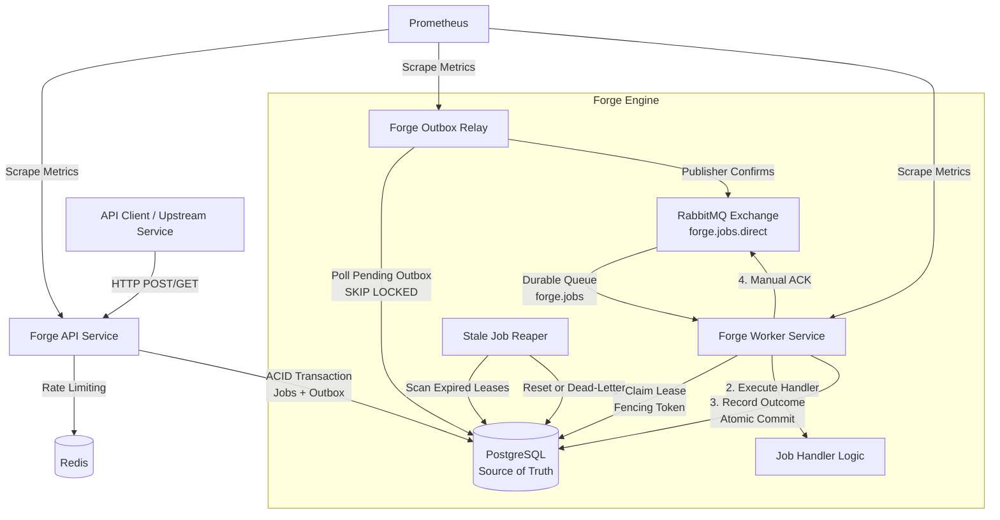
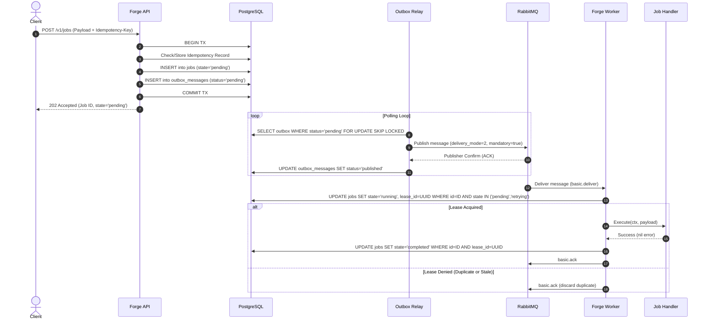
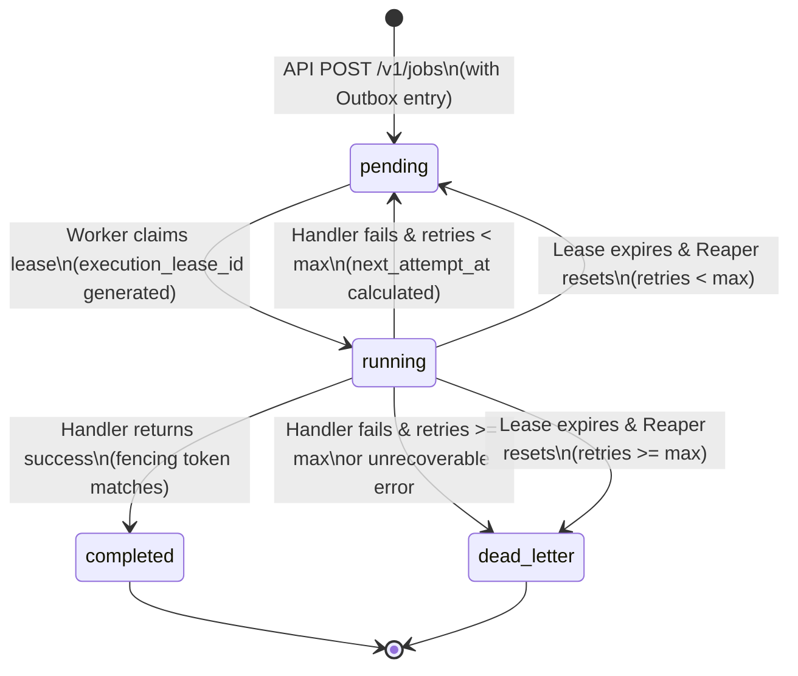

# Forge Architecture Specification

## 1. System Overview & Context

**Forge** is a distributed, fault-tolerant background job processing platform designed to provide guaranteed at-least-once job execution, bounded concurrency, durable retry policies, and transparent observability.

### System Boundaries and Context Diagram



---

## 2. Component Responsibilities

Forge is split into three decoupled executable binaries sharing domain and persistence models:

### 2.1 API Service (`cmd/api`)
- **Ingestion**: Accepts job submissions via REST API (`POST /v1/jobs`).
- **Validation**: Enforces JSON schema, payload size bounds (<= 1MB), allowed job types, priority ranges (0–100), and max retry limits.
- **Client Idempotency**: Evaluates `Idempotency-Key` headers using an `idempotency_records` table to guarantee that duplicate HTTP submissions replay cached responses without creating duplicate jobs.
- **Atomic Persistence**: In a single database transaction, inserts the job record (`state = 'pending'`) and an outbox record (`status = 'pending'`).
- **Read & Management**: Serves job status queries (`GET /v1/jobs/{id}`) and listing queries (`GET /v1/jobs`) directly from PostgreSQL read replicas or primary.
- **Health & Readiness**: Exposes `/healthz` (liveness) and `/readyz` (dependency check: PostgreSQL and Redis).

### 2.2 Outbox Relay (`cmd/outbox-relay`)
- **Isolation**: Prevents dual-write vulnerabilities by ensuring the API never speaks to RabbitMQ.
- **Polling & Claiming**: Queries `outbox_messages` ordered by `scheduled_at ASC` using `SELECT ... FOR UPDATE SKIP LOCKED` in batches.
- **Guaranteed Publish**: Publishes messages to RabbitMQ with **Publisher Confirms** enabled.
- **State Transition**: Upon receiving broker confirmation, marks outbox records as `published` (or deletes them according to retention policies).
- **Scheduled Retry Sweep**: Sweeps retryable jobs whose `next_attempt_at <= NOW()` and pushes outbox delivery events.
- **Backoff & Circuit Breaking**: Backs off during RabbitMQ outages to avoid database thrashing.

### 2.3 Worker Service (`cmd/worker`)
- **Message Consumption**: Connects to RabbitMQ `forge.jobs` queue with bounded prefetch (`basic.qos` set per worker concurrency limit) and manual acknowledgment mode (`autoAck = false`).
- **Atomic Lease Claiming (Fencing)**: Before executing a job, attempts an atomic lease acquisition in PostgreSQL:
  ```sql
  UPDATE jobs 
  SET state = 'running',
      execution_lease_id = $1,
      lease_expires_at = NOW() + $2::interval,
      locked_by = $3,
      started_at = COALESCE(started_at, NOW()),
      retries_attempted = retries_attempted + 1,
      updated_at = NOW()
  WHERE id = $4 
    AND (
      state IN ('pending', 'retrying') 
      OR (state = 'running' AND lease_expires_at < NOW())
    )
  RETURNING id, type, payload, retries_attempted, execution_lease_id;
  ```
- **Execution & Heartbeating**: Executes registered handler with Go `context.Context`. For long-running jobs, a background goroutine extends `lease_expires_at` periodically.
- **Terminal Updates with Fencing Protection**:
  - **Success**: Updates `state = 'completed'`, `completed_at = NOW()`, clearing lease where `id = $id AND execution_lease_id = $lease_id`.
  - **Failure (Retryable)**: Updates `state = 'pending'`, calculates exponential backoff + jitter for `next_attempt_at`, writes new outbox message in the same transaction.
  - **Failure (Exhausted / Poison)**: Updates `state = 'dead_letter'`, writes dead-letter metadata.
- **Manual Acknowledgment**: Emits `basic.ack` to RabbitMQ **only after** the PostgreSQL transaction completes. If database update fails, message is `basic.nack`ed or rejected.

### 2.4 Stale Job Reaper (Background Routine inside Relay/Worker)
- Runs periodically (e.g., every 30 seconds).
- Detects jobs stuck in `state = 'running'` with `lease_expires_at < NOW()`.
- If `retries_attempted < max_retries`, transitions state back to `pending` with immediate `next_attempt_at`.
- If `retries_attempted >= max_retries`, transitions to `dead_letter`.

---

## 3. Data Flow: Job Lifecycle Walkthrough



---

## 4. Database Schema Specification

### 4.1 Tables and DDL

```sql
-- Core Jobs Table
CREATE TABLE jobs (
    id UUID PRIMARY KEY DEFAULT gen_random_uuid(),
    idempotency_key VARCHAR(128) NULL,
    type VARCHAR(64) NOT NULL,
    payload JSONB NOT NULL,
    state VARCHAR(32) NOT NULL DEFAULT 'pending',
    priority INT NOT NULL DEFAULT 0,
    max_retries INT NOT NULL DEFAULT 3,
    retries_attempted INT NOT NULL DEFAULT 0,
    last_error TEXT NULL,
    next_attempt_at TIMESTAMPTZ NOT NULL DEFAULT NOW(),
    execution_lease_id UUID NULL,
    lease_expires_at TIMESTAMPTZ NULL,
    locked_by VARCHAR(128) NULL,
    created_at TIMESTAMPTZ NOT NULL DEFAULT NOW(),
    updated_at TIMESTAMPTZ NOT NULL DEFAULT NOW(),
    started_at TIMESTAMPTZ NULL,
    completed_at TIMESTAMPTZ NULL,

    CONSTRAINT chk_job_state CHECK (
        state IN ('pending', 'running', 'completed', 'failed', 'dead_letter')
    ),
    CONSTRAINT chk_priority_range CHECK (priority >= 0 AND priority <= 100),
    CONSTRAINT chk_retries CHECK (retries_attempted >= 0 AND retries_attempted <= max_retries + 1)
);

-- Transactional Outbox Table
CREATE TABLE outbox_messages (
    id BIGSERIAL PRIMARY KEY,
    job_id UUID NOT NULL REFERENCES jobs(id) ON DELETE CASCADE,
    event_type VARCHAR(64) NOT NULL,
    payload JSONB NOT NULL,
    status VARCHAR(32) NOT NULL DEFAULT 'pending',
    scheduled_at TIMESTAMPTZ NOT NULL DEFAULT NOW(),
    retry_count INT NOT NULL DEFAULT 0,
    last_error TEXT NULL,
    created_at TIMESTAMPTZ NOT NULL DEFAULT NOW(),
    published_at TIMESTAMPTZ NULL,

    CONSTRAINT chk_outbox_status CHECK (
        status IN ('pending', 'published', 'failed')
    )
);

-- Client Idempotency Cache Table
CREATE TABLE idempotency_records (
    key VARCHAR(128) PRIMARY KEY,
    request_hash VARCHAR(64) NOT NULL,
    job_id UUID NOT NULL REFERENCES jobs(id) ON DELETE CASCADE,
    response_code INT NOT NULL,
    response_body JSONB NOT NULL,
    created_at TIMESTAMPTZ NOT NULL DEFAULT NOW(),
    expires_at TIMESTAMPTZ NOT NULL
);

-- Job Execution Audit Log Table
CREATE TABLE job_executions (
    id BIGSERIAL PRIMARY KEY,
    job_id UUID NOT NULL REFERENCES jobs(id) ON DELETE CASCADE,
    attempt INT NOT NULL,
    execution_lease_id UUID NOT NULL,
    worker_id VARCHAR(128) NOT NULL,
    status VARCHAR(32) NOT NULL,
    error TEXT NULL,
    duration_ms INT NULL,
    started_at TIMESTAMPTZ NOT NULL DEFAULT NOW(),
    finished_at TIMESTAMPTZ NULL,

    CONSTRAINT chk_execution_status CHECK (
        status IN ('running', 'completed', 'failed', 'timed_out')
    )
);
```

### 4.2 Indexes & Performance Justification

```sql
-- High-throughput Outbox querying with SKIP LOCKED
CREATE INDEX idx_outbox_pending_scheduled 
ON outbox_messages (scheduled_at ASC, id ASC) 
WHERE status = 'pending';

-- Worker state polling and reaper scans
CREATE INDEX idx_jobs_state_next_attempt 
ON jobs (state, next_attempt_at ASC) 
WHERE state IN ('pending', 'retrying');

CREATE INDEX idx_jobs_stale_reaper 
ON jobs (lease_expires_at ASC) 
WHERE state = 'running';

-- API listing and filtering
CREATE INDEX idx_jobs_type_state_created 
ON jobs (type, state, created_at DESC);

-- Idempotency key fast lookup
CREATE INDEX idx_jobs_idempotency_key 
ON jobs (idempotency_key) 
WHERE idempotency_key IS NOT NULL;

CREATE INDEX idx_idempotency_expires 
ON idempotency_records (expires_at);
```

---

## 5. Job State Machine & Transitions



### State Definitions
| State | Description | Invariant |
|---|---|---|
| `pending` | Job is stored and ready to be dispatched or scheduled for retry. | `execution_lease_id` IS NULL, `next_attempt_at <= NOW()` (or future if delayed). |
| `running` | Job is actively leased and executing on a worker node. | `execution_lease_id` IS NOT NULL, `lease_expires_at > NOW()`. |
| `completed` | Terminal state: Handler finished without error. | `completed_at` IS NOT NULL, `execution_lease_id` IS NULL. |
| `dead_letter` | Terminal state: Retries exhausted or non-retryable fatal error. | `last_error` IS NOT NULL, message sent to DLQ/audited. |

---

## 6. Failure Boundaries & Recovery Mechanisms

| Subsystem Failure | Boundary Impact | Mitigation & Recovery |
|---|---|---|
| **API Process Crash** | In-flight HTTP request drops. | Client retries with `Idempotency-Key`. Database transaction either committed or rolled back cleanly. No partial job states. |
| **Outbox Relay Crash** | Publishing temporarily pauses. | On restart, relay picks up `pending` outbox messages. RabbitMQ publisher confirms ensure messages are safely accepted before marking `published`. Duplicate deliveries handled idempotently by worker. |
| **RabbitMQ Outage** | Message delivery stops. | API continues accepting jobs into PostgreSQL. Outbox relay enters exponential backoff. Once RabbitMQ recovers, outbox drains backlog without data loss. |
| **Worker Crash (Pre-Execution)** | Message unacked in RabbitMQ. | RabbitMQ detects dropped TCP socket and requeues message. Another worker claims the lease and executes. |
| **Worker Crash (Mid-Execution)** | Job remains `running` in PostgreSQL. | Worker heartbeat terminates. Lease expires. Reaper detects `lease_expires_at < NOW()` and re-enqueues job as `pending`. Fencing token prevents resurrecting worker from committing results. |
| **PostgreSQL Outage** | Total system read/write pause. | API returns HTTP 503. Outbox relay pauses publishing. Workers hold messages in unacked state until DB connectivity resumes. Zero data loss. |
| **Redis Outage** | Rate limiting impacted. | API fails open (configurable) to allow mission-critical ingestion while logging alerts. System correctness unaffected as Redis is non-authoritative. |
